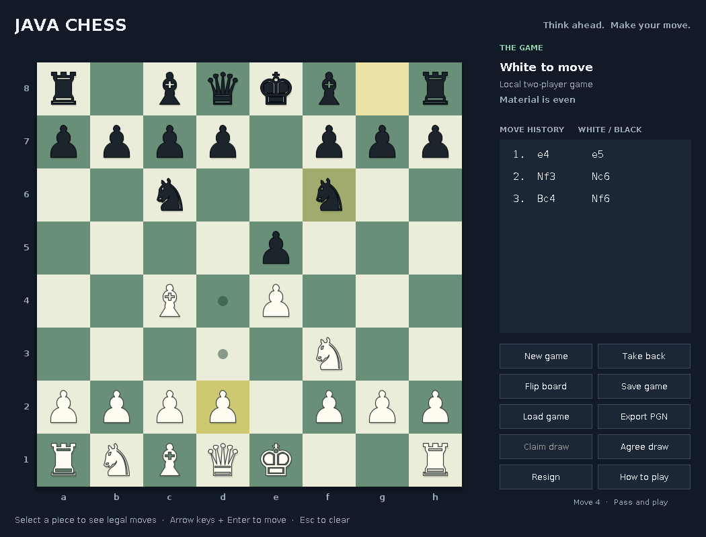

# Unreal Chess

A fast, standalone desktop chess game and chess engine built from scratch in modern Java. It features complete tournament chess rules, an interactive Swing interface, and an adversarial AI opponent powered by minimax with alpha-beta pruning.

Built entirely with standard Java—zero external runtime dependencies required.



---

## Features

- **Full FIDE Chess Rules**:
  - Legal move generation with strict king safety and pin validation.
  - Castling (both kingside and queenside with attacked transit checks).
  - En passant capture with immediate single-turn expiration.
  - Pawn promotion with selection (Queen, Rook, Bishop, Knight).
  - Comprehensive draw conditions: checkmate precedence, stalemate, threefold repetition claims, 50-move rule, fivefold automatic draws, and insufficient material detection.
- **Built-in Chess AI**:
  - Minimax search enhanced with **alpha-beta pruning**, **iterative deepening**, and **quiescence search** to prevent horizon effects.
  - Piece-square positional evaluation tables.
  - Multi-threaded search executing in background worker threads so the desktop UI remains responsive and smooth.
  - Selectable difficulty presets (Easy, Normal, Hard).
- **Interactive Desktop UI (Swing)**:
  - Clean board rendering with legal move highlights and capture indicators.
  - Live move history in standard algebraic notation (SAN).
  - Board flipping, move takebacks, and resign / draw offers.
  - Full game state persistence (save/load via `.chess` format) and standard **PGN export**.
- **Engine Verification**:
  - 79 regression test checks, including Perft move-path enumeration up to depth 4 (197k+ nodes), Kiwipete, and endgame reference positions.

---

## Quick Start

### Prerequisites
- **JDK 17 or newer** (JDK 21 recommended). Check your version:
  ```bash
  java -version
  ```

### Running the App
From the project root:

**On Windows:**
```powershell
./run.bat
```
*(Or launch directly using Java)*:
```powershell
java Build.java run
```

**On macOS / Linux:**
```bash
sh run.sh
```

---

## Testing & Building

The project includes an offline build runner (`Build.java`) that compiles, tests, and packages without requiring Maven or Gradle to be pre-installed:

* **Run all regression & perft tests:**
  ```bash
  # Windows
  ./test.bat

  # macOS / Linux
  sh test.sh
  ```
* **Build executable standalone JAR:**
  ```bash
  # Windows
  ./build.bat

  # macOS / Linux
  sh build.sh
  ```
  The packaged JAR will be generated at `build/unreal-chess.jar`. Run it anytime with:
  ```bash
  java -jar build/unreal-chess.jar
  ```

* **Using Maven (Optional):**
  If you have Maven installed, standard commands also work:
  ```bash
  mvn test
  mvn package
  ```

---

## Architecture Overview

The codebase is organized into modular packages adhering to clean architecture and separation of concerns:

| Package / File | Description |
| :--- | :--- |
| `src/com/chess/board/` | **Board & Pieces**: Immutable position representations, piece models, bitwise/coordinate logic, and legal move generators. |
| `src/com/chess/game/` | **Game Controller**: Move history, algebraic notation (SAN), game outcomes, FEN handling, and PGN export. |
| `src/com/chess/ai/` | **Computer Player**: Adversarial search engine (iterative deepening minimax, alpha-beta cutoffs, positional tables). |
| `src/com/chess/ui/` | **Swing GUI**: Custom board renderer, interactive event listeners, move history sidebar, and dialogs. |
| `test/com/chess/` | **Regression Suite**: Perft benchmarks, illegal move rejection, and endgame rule checks. |

---

## License

This project is open-source under the [MIT License](LICENSE).
